# Teleka Chef Agent

**Agentic food commerce on PayPal.** Tell it what you have in your kitchen; an AI
agent writes a recipe, fills a cart from local vendors, pays with PayPal, and
settles the money to each vendor — closing the loop *from inspiration to plate*.

Built for the **PayPal AI Hackathon 2026** as a focused, self-contained slice of
[Teleka](https://www.teleka.org), a real food social-commerce platform (live on the
App Store). This repo is **not** the full Teleka app — it is the agent + PayPal
layer, runnable on its own.

---

## What it does (the flow)

```mermaid
flowchart LR
  A["You: 'I have rice,<br/>tomato and fish'"] --> B[parse_request]
  B --> C["generate_recipe<br/>(LLM, validated)"]
  C --> D["check_pantry<br/>(plurals, accents,<br/>PT↔EN)"]
  D --> E["search_marketplace<br/>(3 local vendors)"]
  E --> F["create_paypal_order<br/>Orders v2"]
  F -->|buyer approves on PayPal| G["capture_payment"]
  G --> H["verify_amount<br/>(to the cent)"]
  H --> I["pay_vendors<br/>Payouts v1"]
  I --> J["Teleka collection<br/>(social loop)"]
```



1. **You:** "I have rice, tomato and fish" (or in Portuguese: "tenho arroz, tomate e peixe")
2. **Recipe tool (AI):** generates a dish + the full ingredient list, in your language
3. **Pantry check:** skips what you already have, even across languages
   ("arroz" typed by you == "rice" from the AI), and never sells you tap water
4. **Catalog tool:** finds the missing ingredients across three local vendors
   (Luanda and Porto — including Angolan staples like *fuba*, *gindungo* and palm oil)
5. **PayPal — Orders:** the agent creates the order and the buyer approves on PayPal
6. **PayPal — Payouts:** after the captured amount is verified, each vendor is paid their share
7. **Social loop:** the purchase becomes a "collection" on the buyer's Teleka profile

### Real dishes, never nonsense

The agent proposes a **real, well-known dish** — the one a cook would actually make
with what you have — with concrete steps (quantities, times, temperatures):

| You have | The agent cooks |
|---|---|
| chicken + potatoes | Fried chicken with French fries |
| rice + fish (+ tomato) | Portuguese fish rice (*arroz de peixe*) |
| cassava flour (*fuba*) + fish | Funge with fish *calulu* (Angola) |
| eggs + potatoes | Spanish potato omelette |
| eggs + flour + milk | Fluffy pancakes |

`tools/livro.py` is a book of classic dishes. When your ingredients match one, the
agent **locks the dish** and the LLM only writes the recipe (in your language); for
anything else the LLM is asked for a traditional, recognisable dish — no invented
fusions. Without an AI key, the same book cooks offline.

### The agent shows its work

Every tool call is recorded in a **trace** (`tool`, structured `data`, `ms`) that is
returned by the API and rendered in the UI as **Agent activity** — the judge sees
exactly which tool ran, with what result, and how long it took (illustrative run,
sandbox mode):

```
parse_request        Understood 3 ingredient(s): rice, tomato, fish        0 ms
generate_recipe      "Portuguese fish rice" · 9 ingredients ·             3200 ms
check_pantry         You have 3 · missing 6                                0 ms
search_marketplace   6 product(s) from Mercado Kianda, ... · 8.40 USD      1 ms
create_paypal_order  Orders API v2 → 5XK... · PAYER_ACTION_REQUIRED      620 ms
capture_payment      Orders API v2 capture → 3HU... · COMPLETED          740 ms
verify_amount        expected 8.40 USD · captured 8.40 USD · match ✓       0 ms
pay_vendors          Payouts API v1 → 2 vendor(s) · batch ... · PENDING  580 ms
```

## PayPal + AI (for the judges)

- **PayPal** (`tools/paypal.py`): Orders API v2 (`create` / `capture`) for checkout and
  Payouts API v1 to settle each vendor — all against the **PayPal sandbox**.
- **AI** (`tools/recipe.py`): recipe generation via an LLM (Groq / Gemini / any
  OpenAI-compatible endpoint). Free providers; no OpenAI cost.
- **Agentic commerce:** the agent (`agent.py`) chains these **tools** — recipe →
  catalog → order → capture → payouts — with the buyer approving on PayPal before
  any money moves.
- **Safe by design:** the AI chooses the *dish*; it never chooses the *money*.
  Prices and vendor emails come from the server-side catalog, and each order's
  cart is stored on the server when the order is created. Confirming takes only
  the `order_id`, so a tampered browser cannot redirect a payout or change an
  amount. Confirming twice never charges or pays twice (`PayPal-Request-Id` on
  capture, `sender_batch_id = order_id` on payouts, plus a per-order lock), and
  vendors are paid only after the captured amount matches the cart to the cent.

## The Teleka look

The UI uses Teleka's real design tokens (primary `#FF3366` → `#FF6B9D` gradient,
deep navy dark theme `#0B0F1A`, Inter), the Teleka logo, light/dark following the
system, and an **EN / PT** switch (English by default) — the recipe, the cart and the
agent trace all follow the chosen language.

## Quickstart (zero keys — runs offline in mock mode)

```bash
pip install -r requirements.txt

# A) teste rápido por linha de comandos
python run_demo.py "I have rice, tomato and fish"

# B) a demo web (para gravar o vídeo)
uvicorn app:app --reload
# abre http://127.0.0.1:8000
```

With no `.env`, PayPal runs in **mock** mode and recipes come from a built-in **recipe book of real dishes**,
so the whole flow works without any account, key, or internet — perfect for a
reliable demo recording.

## Turn on the real services

Copy `.env.example` to `.env` and fill what you want:

- **AI (free):** get a Groq key at <https://console.groq.com/keys> → set `LLM_API_KEY`.
- **PayPal sandbox:** create sandbox credentials at
  <https://developer.paypal.com/dashboard/applications/sandbox> → set
  `PAYPAL_MODE=sandbox`, `PAYPAL_CLIENT_ID`, `PAYPAL_CLIENT_SECRET`.

In sandbox mode the web demo runs the real buyer flow: **Pay with PayPal**
redirects to PayPal, the buyer logs in with a sandbox *personal* account and
approves, PayPal sends them back, and the app captures and settles the vendors.
Mock mode skips that redirect so the demo also works offline.

> **Payouts:** the vendor emails in `data/catalog.json` must be real sandbox
> accounts, and **not** the business account that owns your app (you cannot pay
> yourself). Create them under *Testing Tools → Sandbox Accounts*. With unknown
> emails the payout stays `UNCLAIMED`.

## Tests

```bash
pip install -r requirements-dev.txt
pytest
```

29 offline tests, including the sandbox path against a simulated PayPal API:
tampered carts, double confirmation, unapproved orders, capture/amount mismatch,
the cross-language pantry check, real-dish selection, and the agent trace.

## Project layout

```
app.py            FastAPI server (serves the UI + /api endpoints)
agent.py          the Chef Agent — orchestrates the tools
run_demo.py       command-line test of the full flow
tests/            offline test suite (pytest)
tools/
  texto.py        ingredient normalisation (plurals, accents) shared by agent + catalog
  recipe.py       recipe generation (Groq/LLM over HTTP, validated, with offline fallback)
  livro.py        recipe book of real, classic dishes (EN/PT)
  catalog.py      mock marketplace search (data/catalog.json)
  paypal.py       PayPal sandbox: Orders + Payouts (with mock mode)
  images.py       free dish image (Pollinations URL, client-side)
static/index.html the demo UI (Teleka theme, EN/PT, agent activity timeline)
static/logo.svg   Teleka logo
data/catalog.json mock vendors (Luanda + Porto) + bilingual products
```

## From demo to production

This slice stays lean on purpose. In the real Teleka backend (Django + Celery),
the dish image is generated **asynchronously** in a Celery task and **cached per
dish**, so the free image provider's rate limit never blocks the user. The agent
and PayPal tools map directly onto Teleka's existing marketplace, wallet and
vendor-payout models.

## License

MIT — see [LICENSE](LICENSE).
